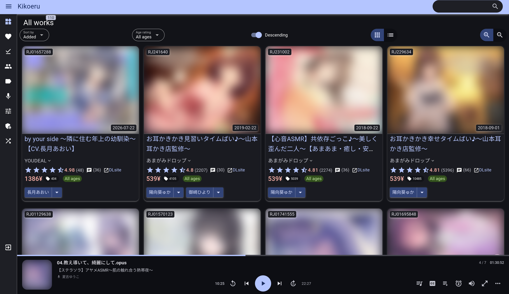

# Kikoenai

> A self-hosted media server for ASMR works.

This is a fork of the original monorepo [Kikoeru](https://github.com/nortonandrews/kikoeru) project, which was forked to make a [Chinese frontend](https://github.com/yodhcn/kikoeru-quasar), which was then forked by [Kikoeru-project](https://github.com/kikoeru-project), which was yet again forked by [Number178](https://github.com/Number178).

Another heavily modified [closed source version](https://asmr.one) seems to exist.

So this repo is created to make the project monorepo again and to continue the development of the project.

## Project screenshot


## Structure

```
kikoenai/
├── package.json            # Root workspace config
├── UPSTREAM.md             # How this fork syncs with Rivers47/Kikoenai
├── backend/                # Express API server (kikoeru-express), TypeScript
│   ├── app.ts              # Server entry point (run natively by Node 26)
│   ├── routes/             # API routes
│   ├── database/           # SQLite (node:sqlite) + Knex
│   ├── filesystem/         # Scanner & file utilities
│   ├── scraper/            # Metadata scrapers (DLSite, etc.)
│   ├── lib/                # Small local replacements for removed packages
│   ├── scripts/build.ts    # esbuild bundler → build/
│   ├── build/              # Self-contained deployment unit (auto-generated)
│   └── dist/               # Frontend build output (auto-generated, copied into build/)
├── frontend/               # Vue 3 / Quasar PWA (kikoeru-quasar)
│   ├── quasar.config.js
│   ├── src/
│   │   ├── components/     # Vue components
│   │   ├── pages/          # Route pages
│   │   ├── store/          # Vuex state
│   │   ├── router/         # Vue Router
│   │   └── boot/           # App boot files
│   └── src-pwa/            # PWA service worker
└── scripts/
    ├── dev.sh              # Start both in dev mode
    ├── build.sh            # Build frontend + backend bundle
    └── package.js          # Build the Windows portable zip
```

## Quick Start

### Windows
Download the portable zip from the release page and unzip it anywhere. Double click
`Kikoenai.bat`. Put your works in `VoiceWork\`.
When upgrading, replace the `app\` folder (and `node\` if the runtime changed) in
your existing installation; your data folders (`config\`, `sqlite\`, `covers\`,
`images\`, `VoiceWork\`) stay where they are.

### First Login

On first run, a default administrator account is created: username `admin`,
password `admin`. 

### Library Organization

First add a library in Settings -> Library -> Add new folder. Than go to Scan -> Scan For New Works.

The server scans for folder names containing `RJxxxxxxx` for DLsite works; 
or `d_xxxxxx` or `dxxxxxx` for Fanza(DMM) works.
You can configure the search depth in settings.

### Container

An OCI container image is built at [here](https://github.com/Rivers47/Kikoenai/pkgs/container/kikoenai)

All persistent data lives under
`/appdata`, mount it to a volume or a persistent path.

```
podman run \
  -v kikoenai-appdata:/appdata \
  -v /path/to/your/voiceworks:/usr/src/kikoeru/VoiceWork \
  -p 4545:8888 \
  ghcr.io/rivers47/kikoenai:latest
```

Sample rootless quadlet config

```
[Unit]
Description=ASMR server

[Container]
Image=ghcr.io/rivers47/kikoenai:latest
ContainerName=kikoenai

Volume=/path/to/appdata:/appdata

Mount=type=bind,src=/path/to/works,dst=/usr/src/kikoeru/VoiceWork,ro=true
AutoUpdate=registry
User=%U:%G
UserNS=keep-id

[Service]
Restart=always

[Install]
WantedBy=multi-user.target default.target
```

Alternatively, use the provided `compose-example.yaml` with with your container compose tool of choice.
Edit `/path/to/your/voiceworks` to your folder that contains the voice work files.

The server will be up on port `4545` on the host.


#### Firefox LNA issue
Due to a bug in Firefox. If you use a local DNS with a public looking hostname
that points at a LAN IP, axio error could occur. The frontend will silently retry to
fix it. Or you can add the domain to `network.lna.skip-domains` in `about:config`

### Change base URL

Set `basePath`
in `config/config.json` or through the web UI.

```json
  "basePath": "/kikoeru"
```

The app is then at `https://example.com/kikoeru/`.

> [!TIP]
> **Your reverse proxy must pass the prefix through, not strip it.** 

```nginx
proxy_pass http://127.0.0.1:8888;  # NOT http://127.0.0.1:8888/  — that would strip /kikoeru
```

In Caddy, use `handle`, not `handle_path`.

If you change the config, restart the server,
and you might need to unregister the service worker
in browser, or just reinstall the app.

### Advanced configuration

For more advanced usage please see the Github Wiki page

## Development

Node **>= 26** is required: the backend is TypeScript that Node runs natively,
so there is no compile step in development.

```bash
# Install all dependencies
npm install

# Start both backend and frontend in dev mode
npm run dev
# Or use: ./scripts/dev.sh
```

This starts:
- **Backend** at http://localhost:8888 (Express API, restarted on changes by `node --watch`)
- **Frontend** at http://localhost:8080 (Quasar dev server with HMR, proxies `/api` to backend)

### Production Build

```bash
# Install dependencies
npm install

# Build the frontend (debug) plus the backend bundle into backend/build/
npm run build

# Or: production frontend (minified) plus the backend bundle
npm run build:prod

# Run the self-contained bundle
npm run start:bundle -w backend
```

`backend/build/` is the deployment unit — `app.mjs`, the forked scanner entry
points, their chunks, the WebApp (`dist/`) and `static/`. It needs Node and the
`ffmpeg`/`ffprobe` binaries, but no `node_modules` and no `.ts` sources.

`npm start` is the other way to run the server: it runs the TypeScript sources
directly (`node app.ts`) and, like the bundle, serves whichever `backend/dist/`
you last built. Set `KIKO_DATA_DIR` to keep data somewhere other than the
application directory (see `backend/AGENTS.md` §2.4).

### Individual Package Scripts

Each package retains its own scripts, accessible via npm workspaces:

```bash
npm run dev:backend      # Backend only (node --watch)
npm run dev:frontend     # Frontend only (quasar dev)
npm run build:frontend   # Build frontend only
npm run build:backend    # Bundle backend only

npm test -w backend      # ESLint + typecheck + node:test
npm run typecheck        # tsc --noEmit
npm run test:bundle -w backend   # Build and smoke-test backend/build/
npm run test:package     # Windows zip writer round-trip test
npm run check:lyrics -- <folder> # Diagnose lyric files in one work folder
npm run package:windows  # Build the Windows portable zip (see scripts/package.js)
```

## Integration

The frontend builds directly into `backend/dist/`, which is served as static content by the Express server. This is configured via `distDir` in `frontend/quasar.config.js`. The backend bundle copies `backend/dist/` and `backend/static/` into `backend/build/`, so that directory is the complete deployable application. The container image and the Windows portable zip both ship exactly that directory.


## TODO
- [x] Migrate packages to their modern versions
- [x] Support multiple languages
- [x] Support other metadata websites
- [ ] Unify code language to English
- [x] Fix PWA issues
- [x] Refresh metadata for a single work
- [x] Optimize DB query speed
- [ ] Tests
- [x] Edit metadata
- [ ] Add user defined work
- [x] DB migration from number178's closed source version
- [ ] DB migration from Kikoeru-project's version
- [x] Container build
- [x] iOS support for opus
- [ ] Migrate frontend to shadcn
- [ ] metadata cache server to replace hvdb/asmrone
- [x] Smarter Play status, hide finished work in history
- [x] Advanced search
- [ ] Fix machine translations of UI and missing tag translations
- [ ] Switch to Pinia

## License

GNU General Public License v3.0
